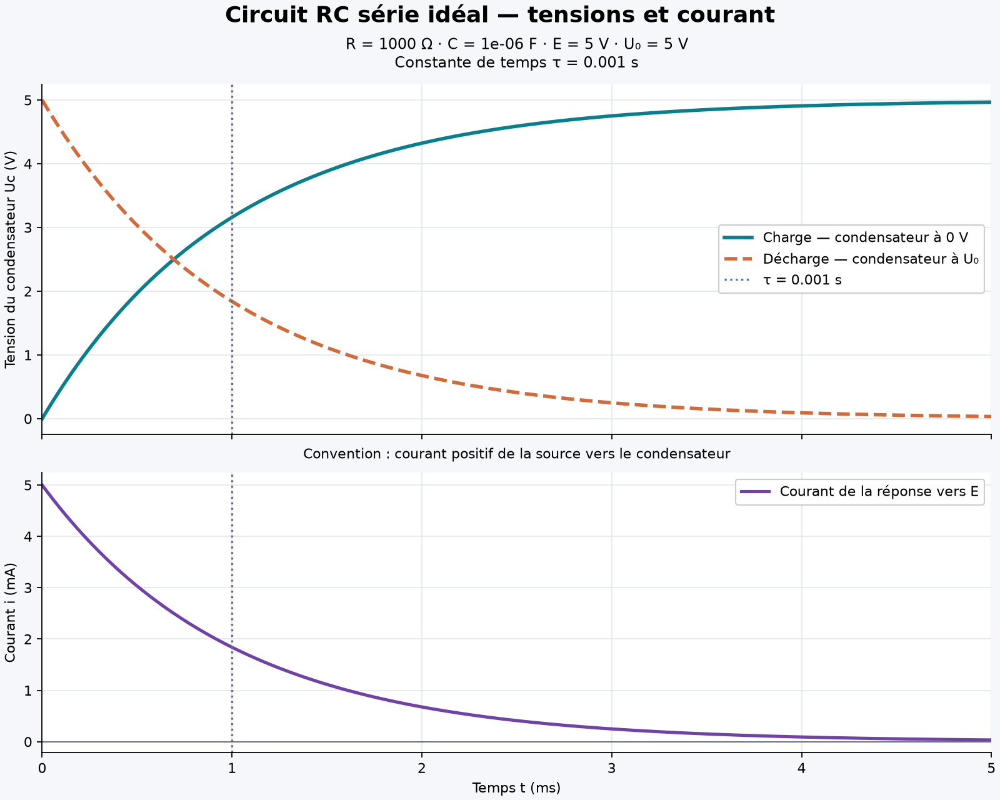

# RC-Simulator-Python

Simulateur scientifique de la réponse temporelle d'un **circuit RC série idéal**.
Le projet relie les lois de l'électronique à des calculs vectorisés NumPy,
des figures Matplotlib et une validation automatisée avec pytest.

La version actuelle calcule la constante de temps, la réponse depuis une
tension initiale quelconque, la décharge et le courant signé. Une application
en ligne de commande exporte les courbes en PNG et les données de la réponse
générale en CSV, sans fenêtre graphique.
Les deux courbes de tension représentent **deux expériences indépendantes** commençant
à t = 0 ; elles ne décrivent pas une commutation successive du même circuit.

## Fonctionnalités disponibles

- Constante de temps, charge, décharge et réponse depuis un état initial quelconque.
- Calcul du courant signé, avec validation des entrées et traitement des limites numériques.
- Figure à deux panneaux : tensions en V et courant de la réponse vers E en mA ou A.
- Export PNG et CSV avec unités explicites, depuis une CLI ou les fonctions Python.
- Tests automatisés de physique, de validation, de compatibilité et des exports réels.

## Modèle scientifique

| Grandeur | Relation | Unité |
| --- | --- | --- |
| Constante de temps | τ = R × C | seconde (s) |
| Réponse générale, Uc(0) = Uc0 | Uc(t) = E + (Uc0 − E) × exp(−t/τ) | volt (V) |
| Charge, Uc(0) = 0 | Uc(t) = E × (1 − exp(−t/τ)) | volt (V) |
| Décharge, Uc(0) = U0 | Uc(t) = U0 × exp(−t/τ) | volt (V) |
| Courant vers le condensateur | i(t) = (E − Uc(t))/R = (E − Uc0)/R × exp(−t/τ) | ampère (A) |

Hypothèses : résistance et capacité constantes, composants et source continue
idéaux, absence d'effets parasites. Lors de la décharge, la source est
déconnectée et le condensateur se décharge uniquement dans R. Les tensions
signées utilisent la même référence de polarité pour la source et le condensateur.

Le courant positif circule de la source vers le condensateur. En convention
récepteur pour C, **i = C × dUc/dt**. Si Uc0 < E, i est positif ; si Uc0 > E,
il est négatif. Une décharge correspond à E = 0 : pour Uc0 > 0, i < 0.
Avec Uc0 = E, la tension reste constante et le courant est nul.

À t = τ, la charge atteint environ **63.2 %** de E et la décharge conserve
environ **36.8 %** de U0. À 5τ, ces valeurs sont environ 99.326 % et 0.674 % :
le régime permanent est approché, jamais atteint exactement à un temps fini
lorsqu'un transitoire existe. Ces pourcentages de E supposent Uc0 = 0 ;
pour un état initial quelconque, l'écart Uc − E conserve 36.8 % de sa valeur
initiale à τ et environ 0.674 % à 5τ.

## Structure du projet

```text
RC-Simulator-Python/
├── src/
│   ├── main.py                  # Arguments, coordination et bilan avec unités
│   └── rc_simulator/
│       ├── __init__.py           # Fonctions publiques du modèle
│       ├── model.py              # Calculs scientifiques, sans Matplotlib
│       ├── plotting.py           # Présentation des données et export PNG
│       └── export.py             # Export CSV validé, sans dépendance graphique
├── tests/
│   ├── conftest.py               # Cache graphique local pour pytest
│   ├── test_model.py             # Lois physiques et limites numériques
│   ├── test_plotting.py          # Données tracées et vrai export PNG
│   ├── test_cli.py               # Application réelle et erreurs de saisie
│   ├── test_response.py          # État initial, courant et limites numériques
│   ├── test_csv.py               # Fidélité CSV et préservation des fichiers
│   ├── test_cli_extensions.py    # Nouvelles options et export effectif
│   ├── test_current_plotting.py  # Courant tracé, unités et validation graphique
│   ├── test_finalisation.py      # Régressions CLI et exports à deux panneaux
│   └── README.md                 # Stratégie de validation
├── docs/README.md                # Démonstration et choix numériques
├── figures/
│   ├── rc_charge_decharge.png    # Exemple de référence
│   └── README.md                # Paramètres et interprétation du graphique
├── requirements.txt             # Versions directes vérifiées
├── pytest.ini                   # Découverte des tests et chemin de src/
├── .gitignore
└── README.md
```

## Environnement et installation

Environnement vérifié : **Python 3.12.7**, **NumPy 2.5.4**, **Matplotlib 3.11.2**
et **pytest 9.1.1**, sous macOS x86_64. Les dépendances sont installées dans
un environnement virtuel local ; aucune installation globale n'est requise.
Les versions directes sont fixées dans `requirements.txt`. Les dépendances
transitives restent résolues par pip.

Depuis ce dossier :

```sh
python3 -m venv .venv
source .venv/bin/activate
python -m pip install -r requirements.txt
python -m pip check
```

L'activation est facultative si chaque commande utilise `.venv/bin/python`.
Dans VS Code, sélectionner `.venv/bin/python` comme interpréteur du projet.

## Exécution et saisie des paramètres

Exemple de référence : **R = 1000 Ω, C = 1e-6 F, E = U0 = 5 V**.

```sh
python src/main.py
```

La constante de temps vaut **0.001 s = 1 ms**. Le programme génère 501 points
entre 0 et 0.005 s et écrit `figures/rc_charge_decharge.png`.
Le panneau supérieur conserve les deux tensions ; le panneau inférieur montre
le courant de la réponse vers E, initialement **5 mA** dans cet exemple.

Paramètres personnalisés, saisis en unités SI :

```sh
python src/main.py --resistance 4700 --capacitance 100e-6 \
  --voltage 12 --initial-voltage 8 --samples 1001 \
  --output figures/rc_4700_100uF.png
```

`--duration` permet de fixer la durée en secondes ; par défaut elle vaut 5τ.
`--initial-voltage` permet de choisir U0 indépendamment de E ; si l'option
est absente, U0 prend la valeur de E. `--help` décrit les arguments.
Cette option conserve son rôle dans la **courbe de décharge indépendante**.
La nouvelle option `--charge-initial-voltage` fixe Uc0 de la réponse vers E
(0 V par défaut), dont le courant est calculé et les données exportées en CSV.
Les préfixes ne sont pas convertis :
1 µF doit être saisi comme `1e-6`, et 4.7 kΩ comme `4700`. Utiliser le point
décimal, sans suffixe d'unité. Une erreur d'entrée produit un message et un
code de retour 2, sans graphique.
Les tensions négatives en notation scientifique sont acceptées, par exemple
`--voltage -1e-3`. Les résistances et capacités négatives restent refusées.

L'export crée le dossier parent s'il manque et **remplace un PNG du même nom**.
Une destination PNG ou CSV qui est un répertoire ou un lien symbolique est refusée.
L'exemple de référence est destiné à être versionné ; les autres PNG exportés,
`.venv/` et les caches sont ignorés. Le cache Matplotlib de l'application et
des tests est local au projet, sauf si `MPLCONFIGDIR` est déjà configuré.

### État initial et export CSV

Réponse vers 5 V depuis 2 V, avec R = 1000 Ω et C = 1 µF :

```sh
python src/main.py --voltage 5 --charge-initial-voltage 2 \
  --output figures/rc_initial_2v.png --csv-output figures/rc_initial_2v.csv
```

Uc(0) = 2 V et i(0) = (5 − 2)/1000 = 0.003 A. À τ = 1 ms,
Uc ≈ 3.89636 V et i ≈ 0.00110364 A. Avec Uc0 = 8 V, la tension descend
vers 5 V et le courant initial vaut −0.003 A.

Pour une décharge depuis 5 V, choisir E = 0 :

```sh
python src/main.py --voltage 0 --charge-initial-voltage 5 --initial-voltage 5 \
  --output figures/rc_discharge.png --csv-output figures/rc_discharge.csv
```

Les deux courbes coïncident dans cet exemple ; le courant initial est
−0.005 A avec la convention de référence retenue. Le panneau inférieur affiche
donc un courant négatif de −5 mA qui tend vers zéro.

Le CSV contient **une simulation**, celle de la réponse vers E, avec les colonnes :

```text
time_s,capacitor_voltage_v,current_a
```

Les nombres sont écrits avec un point décimal et 17 chiffres significatifs,
pour permettre leur relecture exacte en `float64`. Les vecteurs doivent avoir
la même longueur, être finis, et les temps non négatifs et strictement
croissants. Un seul point est accepté par l'API CSV.

Le nom de sortie doit avoir l'extension `.csv` ; un répertoire ou un lien
symbolique comme destination est refusé. Les dossiers manquants sont créés
après validation des données. Un CSV ordinaire existant est remplacé :
l'écriture utilise d'abord un fichier temporaire voisin, puis un remplacement
atomique. PNG et CSV sont des exports distincts : une erreur d'E/S du CSV
peut laisser un PNG déjà créé. Les CSV générés dans `figures/` sont ignorés
par Git. Aucun CSV n'est produit sans l'option `--csv-output`.

### Lecture des courbes

Le courant affiché est celui de la **réponse vers E avec Uc0**, identique à la
colonne `current_a` du CSV. Il ne décrit pas simultanément la courbe orange
de décharge indépendante. Les tensions utilisent le même axe en V ; le courant
dispose de son propre panneau et de sa ligne de référence à zéro.

Si l'amplitude maximale du courant fourni est inférieure à 1 A, le panneau
utilise les mA ; sinon il utilise les A. Cette conversion est uniquement
visuelle : les calculs et CSV restent en ampères. Le temps est affiché en ms
pour un intervalle inférieur à 1 s, sinon en s ; les données restent en secondes.



## Utilisation des fonctions scientifiques

Depuis un script placé dans `src/` :

```python
from rc_simulator import charge_voltage, discharge_voltage, time_constant, time_grid
from rc_simulator import capacitor_voltage, circuit_current
from rc_simulator.export import save_csv

tau = time_constant(1000, 1e-6)
times = time_grid(1000, 1e-6)
charged = charge_voltage(times, 1000, 1e-6, 5)
discharged = discharge_voltage(times, 1000, 1e-6, 5)
response = capacitor_voltage(times, 1000, 1e-6, 5, initial_voltage=2)
current = circuit_current(times, 1000, 1e-6, 5, initial_voltage=2)
save_csv(times, response, current, "figures/simulation.csv")
```

Un temps scalaire donne un `float` ; un vecteur donne un tableau NumPy
`float64`. Les fonctions de calcul n'importent pas Matplotlib et ne modifient
pas les données fournies. Un temps isolé n'est pas contraint par la durée du
graphique. Pour utiliser le module depuis la racine sans installation du paquet,
préfixer la commande Python par `PYTHONPATH=src`.

## Tests

```sh
python -m pytest -q
```

La configuration utilise `src/` comme chemin d'import et transforme les
avertissements inattendus en erreurs. Les tests couvrent les conditions
initiales, les valeurs à τ, les bornes, la monotonie, la complémentarité,
la vectorisation, les entrées invalides, les limites numériques et l'application
réelle. Les tests graphiques vérifient aussi les données tracées et un PNG
de 1600 × 1280 pixels avec courant. Pour préserver l'API existante,
`plot_response()` sans argument `current` conserve sa figure à un panneau,
de 1600 × 960 pixels à la résolution par défaut.
Voir [la stratégie de tests](tests/README.md).

Résultat vérifié sur l'environnement ci-dessus : **224 tests réussis**, dont
les **203 tests précédents conservés sans modification**, sans
avertissement inattendu. Le graphique de référence a été vérifié visuellement.

## Validation et limitations

- R et C doivent être réels, finis et strictement positifs. Un τ infini ou
  arrondi à zéro est refusé ; E, U0 et Uc0 sont finis, nuls ou signés.
- Les temps sont finis et non négatifs. Les fonctions acceptent un scalaire
  ou un vecteur non vide à une dimension, pas une matrice.
- La grille exige 2 à 1 000 000 points distincts. Une durée trop petite ou
  un calcul de 5τ hors plage est refusé ; une durée explicite peut être fournie.
- Les calculs utilisent `float64`, avec précision limitée et arrondis. De très
  petites tensions peuvent s'arrondir à zéro ; aucune borne certifiée d'erreur
  n'est fournie. La constante de temps est elle-même un produit arrondi.
- Le graphe échantillonne une solution analytique : ce n'est pas une résolution
  numérique d'équation différentielle ni une modélisation de composants réels.
- Un courant non fini sur l'un des temps demandés est refusé. Le calcul
  conserve autant que possible un courant tardif représentable, même si la
  tension s'est déjà arrondie à E ; des sous-dépassements restent possibles.
- Pas d'interface graphique interactive, de source variable ou de réseaux de
  plusieurs composants. Le courant tracé correspond uniquement à la réponse
  vers E ; la décharge indépendante n'a pas une seconde courbe de courant.
- Les calculs peuvent traiter des valeurs extrêmes qui sont peu adaptées aux
  axes automatiques de Matplotlib ; les exemples graphiques vérifiés utilisent
  des échelles d'ingénierie usuelles.
- La validation est réalisée sous macOS ; Linux et Windows restent à vérifier.

## Documentation et évolutions

[Modèle physique, unités et choix numériques](docs/README.md).

Évolutions possibles : comparaison avec une intégration numérique, bilan
énergétique et étude des tolérances de R et C.
Ces fonctions ne sont pas implémentées.
